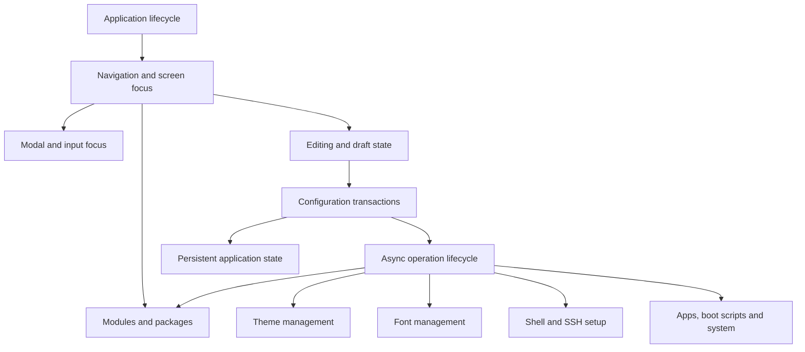
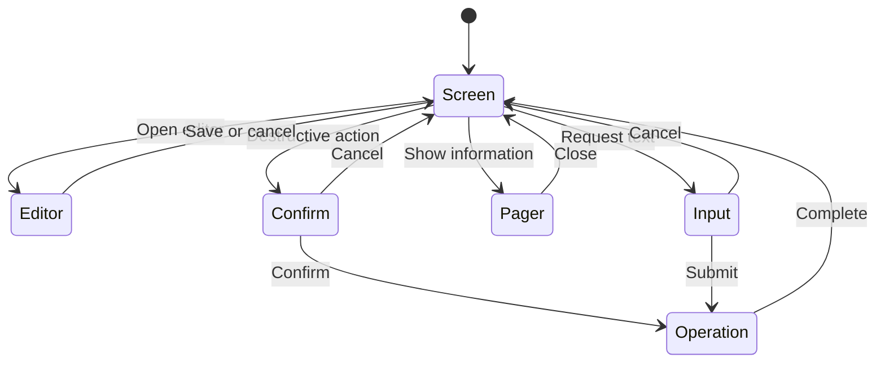
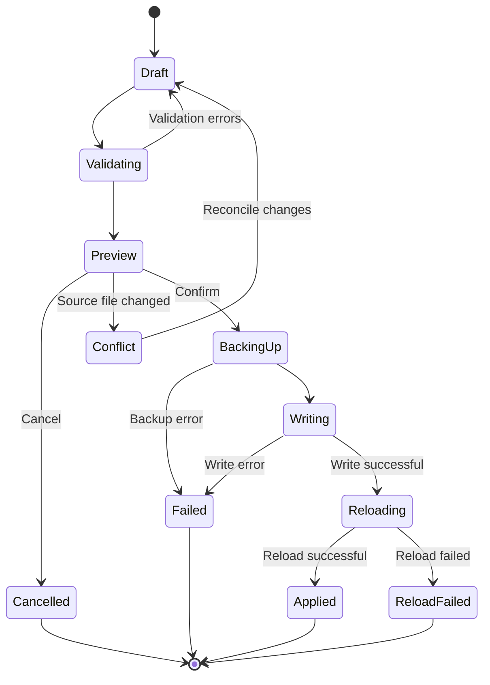
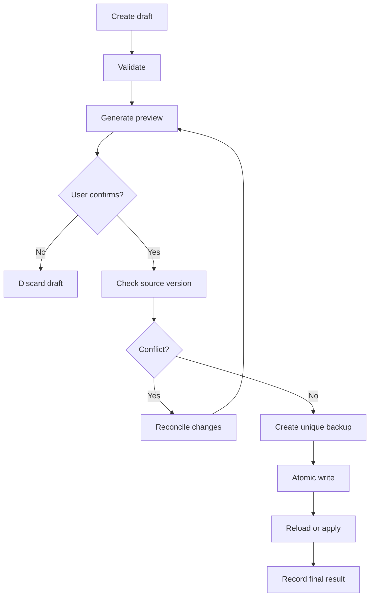

# termux-ui — Implicit State Machine Audit

**Audit date:** November 9, 2026  
**Repository:** [Theblackcat98/termux-ui](https://github.com/Theblackcat98/termux-ui)  
**Branch:** `main`  
**Audited commit:** `6c2fe759fce5e466c85f1caf3b5b84f953b713e6` (November 2, 2026)  
**Scope:** Read-only source inspection. No repository files were modified during the audit.

> **Verification limitation:** This audit is based on inspection of the public GitHub source and repository tree. The repository could not be cloned into the execution environment because outbound DNS/network access was unavailable. Tests were not executed, and behavior was not verified on an actual Termux installation. Findings below distinguish source-confirmed defects from architectural recommendations.

---

## 1. Executive assessment

The application already contains a substantial number of state machines. They are simply not consistently represented as state machines.

Instead, state is distributed across:

- Nullable pointers representing open dialogs.
- Boolean flags representing editing, loading, and execution.
- Integer indexes representing navigation and focus.
- Callback functions representing pending actions.
- Asynchronous Bubble Tea messages representing operation completion.
- Persistent JSON representing restart and update status.
- Filesystem state representing whether an operation actually succeeded.

This works for many normal interactions, but it creates gaps between what the application believes is happening, what the filesystem says happened, and what the user sees.

**Central recommendation:** Do not replace the application architecture or introduce a heavyweight state-management framework. Preserve the existing Go/Bubble Tea structure and introduce a small, consistent state-transition and operation-management layer.

| Dimension | Current limitation | Desired outcome |
|---|---|---|
| UX | Some workflows have ambiguous, incomplete, or misleading states | Predictable interactions, accurate feedback, recoverable operations |
| DX | State is fragmented across booleans, pointers, and callbacks | Explicit transitions, reusable lifecycle primitives, testable behavior |
| AX | Important state is implicit in implementation details | Discoverable states, deterministic transitions, machine-readable operation status |

The largest opportunity is to make the application's existing behavior explicit without unnecessarily changing what users can do.

## 2. State machines identified

Identified **12 major state-machine domains**, encompassing navigation, editors, transactions, background operations, and system-management workflows.

| # | State machine | Main implementation | Assessment |
|---:|---|---|---|
| 1 | Application lifecycle | `app.go`, `main.go` | Partially explicit |
| 2 | Navigation and screen focus | `app.go`, individual screens | Implicit |
| 3 | Modal and input management | `ui.go`, screen models | Fragmented |
| 4 | Configuration editing | `settings.go`, `extrakeys.go` | Partially explicit |
| 5 | Configuration persistence | `termuxconf.go`, screen save flows | Incomplete transaction model |
| 6 | Async operations | `app.go`, screen-specific commands | Fragmented ownership |
| 7 | Restart and update state | `state.go`, `dashboard.go` | Incomplete persistence lifecycle |
| 8 | Modules and packages | `modules.go`, `core.go` | Partially explicit |
| 9 | Themes and colors | `themefont.go`, `theme.go` | Fragmented |
| 10 | Font installation | `themefont.go`, `font.go` | Incomplete |
| 11 | Shell and SSH workflows | `shell.go`, `appssystem.go`, `appssystem2.go` | Partially explicit |
| 12 | Apps, boot scripts and system maintenance | `appssystem.go`, `appssystem2.go` | Fragmented |

These are logical state machines, not necessarily 12 components that should become 12 separate packages.

### Domain relationships



---

# 3. Detailed findings

## 3.1 Application lifecycle

**Files:** [app.go](https://github.com/Theblackcat98/termux-ui/blob/main/internal/app/app.go), [main.go](https://github.com/Theblackcat98/termux-ui/blob/main/main.go)

The root `App` model manages:

- Initialization.
- Screen navigation.
- Global keyboard shortcuts.
- Help overlays.
- Toast notifications.
- Child process execution.
- Application termination.

Some lifecycle state is already explicit:

```go
type App struct {
    width, height int

    core   *core.CLI
    state  *State
    stack  []screen
    toasts ui.Toasts

    showHelp bool
    quitting bool
    tickSeq  int
}
```

The root model does not have one coherent lifecycle for application operations. `quitting` is explicit, but there is no equivalent application-wide representation of whether an operation is executing, whether a file transaction is pending, or whether the application contains unsaved changes.

### Findings

- `ctrl+c` quits immediately, regardless of whether an editor contains unsaved changes.
- Screen transitions can discard the current screen's in-memory state.
- `Push()` and `Pop()` imply a navigation stack, but `jumpTo()` replaces the current child screen instead of preserving a conventional navigation history.
- `tickSeq` is present but unused.
- Root-level handling of asynchronous messages is mixed with screen-specific message handling.

### Recommendation

Introduce explicit application lifecycle state and a consistent navigation contract. Do not add a general-purpose navigation framework.

Keep these concerns distinct:

- Application lifecycle.
- Active screen.
- Active modal.
- Pending user changes.
- Executing operations.

**Priority: P2**

## 3.2 Navigation and keyboard focus

**Files:** [app.go](https://github.com/Theblackcat98/termux-ui/blob/main/internal/app/app.go), [appssystem.go](https://github.com/Theblackcat98/termux-ui/blob/main/internal/app/appssystem.go), [appssystem2.go](https://github.com/Theblackcat98/termux-ui/blob/main/internal/app/appssystem2.go), [themefont.go](https://github.com/Theblackcat98/termux-ui/blob/main/internal/app/themefont.go)

The application determines whether global keys are available using:

```go
WantsGlobalKeys() bool
```

Each screen implements this independently. A screen must correctly identify every condition in which a modal, text input, or other interaction should capture keyboard input.

### Confirmed defect: boot-script filename input

`appsSystemScreen` has:

```go
bootNameOpen bool
```

However, `WantsGlobalKeys()` checks:

```go
return s.confirm == nil &&
    s.pager == nil &&
    !s.passwdOpen
```

It does not check `bootNameOpen`.

Consequently, while entering a boot-script filename:

- Pressing `1`–`7` can navigate away.
- Pressing `?` opens global help.
- Pressing `esc` can leave the screen instead of closing the input.

The application treats an active text-input modal as if normal screen navigation were still available.

### Related defect: font operations

`fontTab.busy()` returns:

```go
return f.localMode || f.confirm != nil
```

It does not include `f.working`. Therefore, the user can navigate away while a download/install operation is running or potentially initiate another operation.

### Recommendation

Replace independently maintained modal checks with a shared focus contract:

- Normal screen interaction.
- Modal navigation.
- Text input.
- Confirmation.
- Read-only pager.
- Background operation.

The root model should decide which keyboard shortcuts are available based on the actual interaction state.

**Priority: P1**

## 3.3 Modal and input state management

**Files:** [ui.go](https://github.com/Theblackcat98/termux-ui/blob/main/internal/ui/ui.go), individual screen models.

The shared UI package provides reusable components:

- `Menu`
- `Toggle`
- `Radio`
- `TextInput`
- `Confirm`
- `Pager`
- `Toasts`

The containing screens manage their lifecycles differently. One screen might have:

```go
confirm *ui.Confirm
pending func(a *App) tea.Cmd
```

Another has:

```go
customOpen  bool
paletteOpen bool
importOpen  bool
```

Another has:

```go
editor     *ekCellEditor
presetOpen bool
diffPager  *ui.Pager
```

There is no shared guarantee that these states are mutually exclusive or that all transitions are handled consistently.

### Why this matters

A screen can potentially represent contradictory combinations of state:

- An editor is open while a confirmation is pending.
- A font operation is executing while a new operation can be initiated.
- A modal is displayed while global shortcuts remain active.
- An operation completes after the screen that initiated it is gone.

Some screens avoid these combinations through carefully ordered `if` statements, but the guarantees are distributed across implementation details.

### Recommendation

Use a small modal-state abstraction and a clear priority order.



Implement incrementally. There is no need to rewrite every existing widget.

**Priority: P2**

## 3.4 Configuration editing and draft state

**Files:** [settings.go](https://github.com/Theblackcat98/termux-ui/blob/main/internal/app/settings.go), [extrakeys.go](https://github.com/Theblackcat98/termux-ui/blob/main/internal/app/extrakeys.go), [themefont.go](https://github.com/Theblackcat98/termux-ui/blob/main/internal/app/themefont.go)

There are several distinct editing state machines.

### Termux settings

The settings editor tracks:

- Original/effective value.
- Current edited value.
- Validation errors.
- Modified count.
- Current group.
- Focused property.

This is a reasonable foundation. However, a settings field's state is distributed among `toggle`, `radio`, `text`, and `effective`.

There is also an important issue with external changes: `buildDoc()` loads the latest file and applies all screen field values, including values the user never modified.

For example:

1. The user opens Termux Settings.
2. Another process modifies `volume-keys`.
3. The user changes an unrelated property.
4. The user saves.

The stale `volume-keys` value held by the screen can overwrite the newer external value. The resulting diff may reveal the overwrite, but the application does not detect the conflict or distinguish intentional changes from stale state.

There is a second race between reviewing a diff and confirming it: another application can modify the file after the preview is prepared and before the save happens.

The `oldContent` argument passed into `commitProperties()` is not used for conflict detection.

### Extra Keys Builder

The extra-keys editor has:

- Grid navigation.
- Cell editing.
- Named key selection.
- Popup editing.
- Macro editing.
- Preset selection.
- Diff review.
- Save/reload.

This is another substantial state machine, but it has a concrete functional defect.

**The companion settings are not keyboard-editable.**

The screen displays:

- `extra-keys-style`
- `extra-keys-text-all-caps`

But its key handling does not provide transitions that change either the radio selection or the toggle.

The save code serializes both values, and tests directly manipulate the underlying Go structs. Tests can therefore pass while the actual keyboard interaction remains inaccessible.

There is another edge case: if an existing `extra-keys` value fails to parse, the constructor leaves the layout empty. Subsequent grid navigation can index into an empty `Rows` slice and panic.

### Theme custom editor

The theme editor has custom editing, palette browsing, import, preview, apply, and reset/delete. Its editing state is independent of the other screen editors.

### Recommendation

Introduce a consistent draft lifecycle:

`clean → dirty → validating → review → committing → applied`

With explicit failure and cancellation paths.

A draft should track:

- Original snapshot.
- Current value.
- Dirty fields.
- Validation errors.
- Whether external changes have occurred.
- Whether the user has committed or discarded the changes.

**Apply only the user's intentional changes.** Do not apply all screen values indiscriminately.

**Priority: P1**

## 3.5 Configuration persistence and transaction lifecycle

**Files:** [termuxconf.go](https://github.com/Theblackcat98/termux-ui/blob/main/internal/termuxconf/termuxconf.go), [settings.go](https://github.com/Theblackcat98/termux-ui/blob/main/internal/app/settings.go), [extrakeys.go](https://github.com/Theblackcat98/termux-ui/blob/main/internal/app/extrakeys.go), [util.go](https://github.com/Theblackcat98/termux-ui/blob/main/internal/app/util.go)

This is the most consequential architectural finding.

The application uses a safety-oriented write process:

1. Prepare changes.
2. Display a unified diff.
3. Obtain confirmation.
4. Create a backup.
5. Write the new file.
6. Reload Termux settings.
7. Report the result.

That is a sound workflow in principle, but it is not implemented as one consistent transaction state machine.

### Confirmed problems

**A. Concurrent writes can collide.**

`termuxconf.Save()` uses:

```go
tmp := path + ".tmp"
```

The backup name has one-second timestamp precision:

```go
orig + ".bak." + now.Format("20060102-150405")
```

This creates two problems:

- Simultaneous writes to the same file can share the same temporary path.
- Multiple writes during one second can overwrite the same backup.

Because the application permits navigation while some asynchronous commands are running, overlapping configuration operations are possible.

A backup system should never silently replace the only previous recovery point.

**B. There is no external-change protection.**

The file may change between reading, reviewing, and writing. There is no hash/version comparison before committing.

**C. Reload failure is not modeled separately from write failure.**

Consider:

1. Backup succeeds.
2. The new configuration is written successfully.
3. `termux-reload-settings` fails.

The configuration is now changed on disk, but the application reports a generic failed operation. Retrying a failed write is not the same as retrying a reload.

**D. Different operations implement different transaction semantics.**

Termux properties use `termuxconf.Save()`. Theme files use `saveWithBackup()`. Font installation writes directly to `font.ttf`.

Their backup, atomicity, reload, and error-reporting behavior differ.

### Recommendation: shared file transaction service

Keep the existing parser and serialization behavior. Introduce a shared service responsible for:

- Capturing the original file snapshot.
- Building the candidate file.
- Producing the preview.
- Checking for external modifications.
- Creating a unique backup without overwriting an existing backup.
- Writing through a uniquely named temporary file in the same directory.
- Performing the atomic replacement.
- Reporting reload status independently from write status.

Transaction lifecycle:



The distinction between `Applied` and `ReloadFailed` is essential. A configuration file can be successfully committed even when the reload command fails.

**Priority: P1 — highest architectural priority**

## 3.6 Async operation lifecycle

**Files:** [app.go](https://github.com/Theblackcat98/termux-ui/blob/main/internal/app/app.go), [modules.go](https://github.com/Theblackcat98/termux-ui/blob/main/internal/app/modules.go), [dashboard.go](https://github.com/Theblackcat98/termux-ui/blob/main/internal/app/dashboard.go), [themefont.go](https://github.com/Theblackcat98/termux-ui/blob/main/internal/app/themefont.go)

The application uses several types of background work:

- `tea.ExecProcess()` for interactive child processes.
- `tea.Cmd` for network downloads.
- `tea.Cmd` for reading system information.
- `tea.Cmd` for loading module status.
- `tea.Cmd` for configuration writes and reloads.

The root model handles `childDone`, but many other messages are handled only by the current screen. Examples include `fontDoneMsg`, `textMsg`, `listMsg`, and `updateMsg`.

### Ownership problem

The application routes ordinary messages to:

```go
a.current().Update(a, msg)
```

The receiving screen might not be the screen that initiated the work.

For example:

1. User initiates a font download.
2. The network request begins.
3. User jumps to another screen.
4. The download completes and installs the font.
5. `fontDoneMsg` reaches a different screen.
6. That screen does not understand the message.

The filesystem operation may succeed while the user receives no meaningful completion notification. The user can reasonably interpret missing feedback as a failed operation.

### Recommendation

Introduce a root-owned operation registry.

Every operation should receive an identifier and have an explicit lifecycle:

- `pending`
- `running`
- `succeeded`
- `failed`
- `partially_succeeded`
- `cancelled`

Each operation should record its type, affected resource, start time, completion result, and initiating screen.

The root model should always receive the completion event, regardless of which screen is active.

This provides a foundation for preventing simultaneous writes to the same resource.

**Priority: P1**

## 3.7 Persistent application state and restart tracking

**Files:** [state.go](https://github.com/Theblackcat98/termux-ui/blob/main/internal/app/state.go), [dashboard.go](https://github.com/Theblackcat98/termux-ui/blob/main/internal/app/dashboard.go), [settings.go](https://github.com/Theblackcat98/termux-ui/blob/main/internal/app/settings.go), [schema.go](https://github.com/Theblackcat98/termux-ui/blob/main/internal/app/schema.go)

Persisted state includes:

```go
type State struct {
    RestartPending  map[string]time.Time
    LastUpdateCheck time.Time
    LatestVersion   string
}
```

This is a small persistence layer, but its lifecycle is incomplete.

### Finding A: restart entries never clear

`State.ClearRestart()` exists, but no application call sites were found. Once a property is marked restart-required, it can remain in the dashboard indefinitely. The application does not provide a corresponding acknowledgement or clearing workflow.

### Finding B: inconsistent restart definitions

`restartRequired` in `schema.go` includes:

```go
"use-fullscreen-workaround": true
```

But the corresponding property definition does not include `Restart: true`.

The settings screen determines its restart banner and restart icon using `propDef.Restart`. Therefore, changing this property can bypass the expected restart indication.

This is two sources of truth disagreeing.

### Finding C: restart state is only recorded after reload success

`commitProperties()` marks restart-required properties in the branch where `termux-reload-settings` succeeds.

If the file was successfully written but the reload command fails, the application does not persist the restart requirement.

### Finding D: shell changes are inconsistently tracked

`runCoreOp()` tracks `shell-stack` after `core install shell`. However, shell updates/reinstalls and the successful `chsh` operation do not consistently create a persistent restart entry, even though the UI tells the user to restart Termux.

### Recommendation

Use one restart-requirement definition, derived from the property schema.

Persist restart state whenever the relevant change is successfully written, irrespective of reload success. Include the operation that caused the requirement and an explicit user acknowledgement mechanism.

Do not assume that the application can reliably infer whether Android has fully restarted Termux.

**Priority: P1**

## 3.8 Modules and package management

**Files:** [modules.go](https://github.com/Theblackcat98/termux-ui/blob/main/internal/app/modules.go), [core.go](https://github.com/Theblackcat98/termux-ui/blob/main/internal/core/core.go), [catalog.go](https://github.com/Theblackcat98/termux-ui/blob/main/internal/catalog/catalog.go)

This screen contains several state machines:

- Module discovery.
- Live status loading.
- Static catalog fallback.
- Multi-tool selection.
- Install.
- Update.
- Uninstall.
- Reinstall.
- Documentation display.
- Log inspection.

This is one of the better-separated functional areas. It distinguishes unknown package status from installed and not installed, and merges live data with the static catalog.

However, several operations still lack a shared lifecycle.

Loading status uses:

```go
loading map[string]bool
errs    map[string]string
```

Package selections are separately stored in:

```go
checked map[string]bool
```

The actual operation is dispatched through another mechanism.

### Improvement opportunities

Operation state should distinguish:

- Not loaded.
- Loading.
- Loaded.
- Loading failed.
- Using catalog fallback.
- Operation executing.
- Operation completed.
- Operation failed.

This would allow better user feedback and make it easier for agents to determine whether displayed install status is authoritative or merely a fallback.

Preserve the user's selected module and tool cursor when refreshing status instead of rebuilding unrelated screen state.

### Recommendation

Keep the existing `core` adapter and static catalog. Unify the state representation and operation status rather than rewriting package management.

**Priority: P2**

## 3.9 Theme and color management

**Files:** [themefont.go](https://github.com/Theblackcat98/termux-ui/blob/main/internal/app/themefont.go), [theme.go](https://github.com/Theblackcat98/termux-ui/blob/main/internal/theme/theme.go)

The theme subsystem supports:

- Selecting bundled themes.
- Custom editing.
- Importing properties files.
- Browsing the 256-color palette.
- Applying themes.
- Resetting to application defaults.

The functionality is established, but there is an inconsistency in the safety model.

### Confirmed problem: custom theme application bypasses review

`applyThemeCmd()` calculates a diff:

```go
diff := termuxDiff(string(oldData), newContent)
_ = diff
```

The diff is discarded.

The custom editor then applies the generated theme without displaying that diff or requesting a separate confirmation.

The bundled theme path has a confirmation dialog, but it still does not display the actual diff.

This conflicts with the repository's documented write-safety model.

### Other issues

- The custom editor remains open after applying.
- Reload failure is reported as an application failure, even though the file may already have changed.
- The `pager` field is present in the colors model but does not appear to be integrated into the workflow.
- The same transaction logic is independently implemented here instead of using the configuration transaction mechanism.

### Recommendation

Make theme application follow the same transaction lifecycle as Termux settings.

A user should be able to see the actual modifications before committing them.

The theme editor should distinguish:

- Draft preview.
- Saved configuration.
- Reload success.
- Reload failure.

**Priority: P1**

## 3.10 Font installation and removal

**Files:** [themefont.go](https://github.com/Theblackcat98/termux-ui/blob/main/internal/app/themefont.go), [font.go](https://github.com/Theblackcat98/termux-ui/blob/main/internal/font/font.go)

Font management has a separate lifecycle:

`select font → download → extract → validate → backup → install → reload`

It also supports local `.ttf` installation and removal.

### Confirmed defects

**A. The busy state is incomplete.**

`fontTab.working` exists, but `fontTab.busy()` does not include it. Local font installation also does not consistently set `working`.

This permits overlapping operations and navigation while an installation is in progress.

**B. Font installation is not atomic.**

`font.Install()` writes directly to `font.ttf`. Unlike the configuration writer, it does not use a temporary file followed by an atomic rename. An interrupted write could leave a damaged font file.

**C. Failed reload is incorrectly interpreted.**

The installation can succeed while the reload fails. The UI currently reports an error but does not model the distinction between installation and application.

### Recommendation

Use the shared operation lifecycle and shared backup/atomic replacement mechanism.

Do not force binary font installation into the textual diff-preview workflow; instead provide an appropriate binary-file confirmation and backup record.

**Priority: P1**

## 3.11 Shell, SSH and boot-script workflows

**Files:** [shell.go](https://github.com/Theblackcat98/termux-ui/blob/main/internal/app/shell.go), [appssystem.go](https://github.com/Theblackcat98/termux-ui/blob/main/internal/app/appssystem.go), [appssystem2.go](https://github.com/Theblackcat98/termux-ui/blob/main/internal/app/appssystem2.go)

These workflows contain important implicit multi-step state machines.

### Shell setup

The main transitions are:

- Check shell installation.
- Install/update/reinstall ZSH stack.
- Choose the default shell.
- Confirm `chsh`.
- Restart Termux.
- Configure powerlevel10k.

The shell refresh calls `core.List("shell")` synchronously from the screen refresh handler. Opening the screen or refreshing it can block the event loop while the subprocess executes.

**Recommendation:** make status loading asynchronous.

### SSH setup

The SSH workflow has:

1. Install OpenSSH.
2. Set password.
3. Start `sshd`.
4. Display connection information.
5. Stop `sshd`.

The password input workflow is defective.

The screen collects a masked password and exports it into:

```go
TUI_SUGGESTED_PW
```

However, the child shell command never reads that environment variable.

As a result, the user's typed password is not actually supplied to `passwd`. The user must type it again in the child terminal.

The value is also unnecessarily retained in a child process environment.

Additionally, `stty -echo` is used without a reliable restoration mechanism if the command exits unexpectedly.

**Recommendation:** simplify the workflow and let the native `passwd` interaction handle password entry directly through the child terminal, unless a properly implemented terminal/PTY-based password workflow is introduced.

### Boot-script creation

Two additional problems:

**A. Filename path traversal**

The filename is passed to:

```go
filepath.Join(homePath(".termux/boot"), name)
```

The name is not constrained to a filename. Inputs containing path separators or traversal components can create files outside the intended boot directory.

Restrict it to a validated basename.

**B. Blank template does not open the editor**

The blank template branch calls:

```go
a.OpenInEditor(path)
```

But discards the returned command and then proceeds to create the file.

Consequently, the requested editor operation is never actually scheduled.

The correct order is to create the file successfully and then open the editor through the completion workflow.

### Recommendation

Represent each wizard explicitly with:

- Current step.
- Preconditions.
- Available transitions.
- Operation result.
- Recovery path.
- Completion state.

These should remain independent of the screen's general-purpose menu navigation.

**Priority: P1**

## 3.12 Apps and system maintenance

**Files:** [appssystem.go](https://github.com/Theblackcat98/termux-ui/blob/main/internal/app/appssystem.go), [appssystem2.go](https://github.com/Theblackcat98/termux-ui/blob/main/internal/app/appssystem2.go)

This includes:

- Storage permissions.
- Companion app checks.
- Termux API self-test.
- Boot directory creation.
- Widget shortcuts.
- SSH status.
- Boot script management.
- Package mirrors.
- Package upgrades.
- System information.

### Main architectural issue: status inspection happens during rebuilding and rendering

`rebuild()` invokes multiple system operations:

- `dpkg -s`
- `pgrep`
- `ip`
- `ifconfig`
- `os.ReadDir`
- File-status checks.

The screen may rebuild during navigation, and `View()` calls `rebuild()` when the rows are empty.

This means rendering is not purely rendering. It can trigger filesystem and subprocess work.

The screen performs environmental discovery as a side effect of presentation.

### Additional issue: false success notifications

Some directory-creation operations ignore `os.MkdirAll()` errors and immediately show success notifications.

For example, creating `~/.termux/boot` can fail while the user is still told the directory is ready.

### Recommendation

Separate the states into:

- Environment inspection.
- Inspection in progress.
- Inspection completed.
- Inspection failed.
- User action available.
- User action executing.
- User action completed.

Cache inspection results and update them through asynchronous commands.

This improves responsiveness and avoids side effects during rendering.

**Priority: P2**

---

# 4. Cross-cutting defects to address first

The individual state machines expose issues that affect the entire application.

| Priority | Finding | Impact |
|---|---|---|
| P1 | Same temporary filename and second-precision backup naming | Concurrent-write collisions and lost recovery points |
| P1 | No file-version check before committing reviewed changes | External modifications can be overwritten |
| P1 | Async results are routed to whichever screen is active | Lost completion feedback and inconsistent operation state |
| P1 | Incomplete modal/focus handling | Keyboard navigation can escape active input |
| P1 | Restart-state inconsistencies | Incorrect or persistent restart warnings |
| P1 | Boot-script path traversal | Files can be created outside the intended directory |
| P1 | SSH password input is not actually used | Misleading and potentially unsafe workflow |
| P1 | Theme custom application bypasses diff review | Violates documented write-safety behavior |
| P1 | Font operations are not consistently serialized | Concurrent installs and missing feedback |
| P2 | Toast expiration stops when the queue becomes empty | Later notifications may never disappear |
| P2 | System status inspection occurs synchronously | Navigation and rendering can block |
| P2 | Config loading errors can cause nil-pointer panics | Unreadable configuration files can crash screens |
| P2 | Extra Keys companion controls are not editable | Visible controls do not function |
| P2 | Blank boot template editor command is discarded | Broken workflow |
| P2 | Draft cancellation is not consistently guarded | Users can lose unsaved changes |

### 4.1 Toast expiration

`App.Init()` schedules a toast timer.

`HandleMsg()` schedules the next timer only when `ExpireOldest()` reports that more messages remain.

When the queue becomes empty, the timer stops. New notifications do not restart it.

Consequently, notifications created after that point can remain visible indefinitely.

**Fix:** schedule expiration based on actual message timestamps or restart the timer when adding a toast.

### 4.2 Configuration loading can panic

`settingsScreen.load()` continues after `termuxconf.Load()` returns an error. It then calls `effectiveValue(doc, d)`.

If `doc` is nil because the file was unreadable, this can panic.

The extra-keys constructor similarly ignores the load error before accessing the document.

These paths need explicit error and fallback states rather than assuming every filesystem error means an empty configuration.

---

# 5. Recommended architecture

Introduce four small architectural improvements. They address nearly every finding without requiring a rewrite.

## 5.1 Explicit state-transition models

Move away from combinations of booleans and nullable pointers as the primary representation of workflow state.

For example, the current approach:

```go
type fontTab struct {
    localMode bool
    confirm   *ui.Confirm
    working   bool
}
```

Preferred conceptual approach:

```go
type FontPhase uint8

const (
    FontIdle FontPhase = iota
    FontSelecting
    FontAwaitingConfirmation
    FontDownloading
    FontExtracting
    FontInstalling
    FontReloading
    FontApplied
    FontReloadFailed
    FontFailed
)
```

This is illustrative, not a recommendation to mechanically convert every boolean into an enum.

The objective is to represent meaningful, mutually exclusive workflow phases explicitly. Each state should define valid transitions, and invalid transitions should be rejected or deliberately ignored.

## 5.2 Root-owned operation management

Give every background operation an identity.

For example:

```go
type Operation struct {
    ID        string
    Type      string
    Resource  string
    Phase     OperationPhase
    StartedAt time.Time
    Error     string
    Result    string
}
```

The root application should own operation lifecycle and completion messages.

This solves several problems simultaneously:

- Completion messages cannot disappear because the user changed screens.
- Duplicate operations can be prevented.
- Concurrent file writes can be serialized.
- The interface can display real progress.
- Agents can inspect operation state.
- Errors can distinguish complete failure from partial success.

Introduce resource-level locks for shared targets such as:

- `~/.termux/termux.properties`
- `~/.termux/colors.properties`
- `~/.termux/font.ttf`
- Package-management operations.

This is safer than disabling every screen while any operation runs.

## 5.3 Shared transaction and recovery service

A small service should own filesystem mutations.



The service should centralize:

- Unique backup naming.
- Atomic replacement.
- File permissions.
- Conflict detection.
- Per-resource serialization.
- Write/reload result separation.
- Recovery information.

It should not own editor-specific behavior or decide what constitutes a valid theme or extra-keys layout. Those responsibilities should remain with their respective domain packages.

## 5.4 Machine-readable state for agents

This is the most important opportunity for AX.

An agent working on this repository should not need to reverse-engineer the UI to discover what the application is doing.

The application should make the following information explicit:

| Information | Why it matters |
|---|---|
| Current screen | Determines application context |
| Active modal | Determines keyboard/input ownership |
| Current workflow phase | Determines available transitions |
| Dirty state | Prevents accidental loss of changes |
| Validation state | Identifies blocked actions |
| Operation identifier | Correlates async work |
| Operation phase | Distinguishes executing from completed |
| Resource lock | Prevents conflicting operations |
| Persistent restart requirements | Explains pending system actions |
| Last operation result | Enables diagnosis and recovery |

The agent should be able to answer:

- Is the application currently editing a configuration?
- Are there unsaved changes?
- Is a file write underway?
- Did the configuration change successfully?
- Did the reload fail?
- Is another operation modifying the same file?
- Does the user need to restart Termux?

Those answers should come from structured state, not interpretation of toast strings or screen contents.

---

# 6. Recommended implementation order

Do not refactor all 12 areas simultaneously. The following order minimizes risk and builds reusable foundations before touching dependent screens.

## Phase 1 — Correctness and safety

Fix confirmed functional and data-integrity problems:

1. Fix boot-script path validation.
2. Correct the SSH password workflow.
3. Fix the blank-template editor.
4. Restore functional Extra Keys companion controls.
5. Handle invalid configuration files safely.
6. Fix modal/global keyboard ownership.
7. Correct restart tracking and toast expiration.

## Phase 2 — Transaction infrastructure

1. Introduce a shared atomic file writer.
2. Guarantee unique backup files.
3. Detect external modifications before commit.
4. Separate write success from reload success.
5. Serialize operations targeting the same resource.
6. Bring theme application into the shared review workflow.

## Phase 3 — Explicit operation lifecycle

1. Introduce root-owned operation tracking.
2. Add operation IDs and typed completion messages.
3. Prevent duplicate conflicting operations.
4. Track partial success.
5. Make background completion independent of active screen.

## Phase 4 — Consistent screen state

1. Standardize modal and editor lifecycles.
2. Add shared draft-state handling.
3. Separate system inspection from rendering.
4. Add explicit navigation and discard policies.
5. Remove dead or redundant state fields.

## Phase 5 — AX and regression coverage

1. Add transition-table tests.
2. Add operation lifecycle tests.
3. Add filesystem conflict and recovery tests.
4. Add failure-injection tests.
5. Document state contracts for future development agents.

---

# 7. Testing that should accompany the changes

The current test suite has a useful foundation: shared UI tests, configuration tests, module tests, and headless screen smoke tests.

However, coverage does not adequately test the transitions where the problems identified above occur.

| Test | Expected invariant |
|---|---|
| Open filename modal and press `1` | Text input receives the key; no navigation |
| Open filename modal and press `esc` | Modal closes; screen remains active |
| Start font installation and switch screens | Completion is still recorded |
| Start two font installations | Second conflicting operation is rejected or serialized |
| Two configuration saves in the same second | Both backups remain recoverable |
| Configuration changes externally after draft creation | Commit detects a conflict |
| Configuration changes externally after preview | Commit does not silently overwrite it |
| Reload fails after successful write | State reports saved but not reloaded |
| Change `use-fullscreen-workaround` | Restart requirement is recorded |
| User acknowledges a restart | Persisted restart entry is cleared |
| Invalid extra-keys configuration | Safe recovery, no panic |
| Permission-denied configuration file | Error state, no panic |
| Custom theme application | Diff review occurs before write |
| Blank boot template | File is created and editor launches |
| Boot filename contains `../` | Rejected |
| Password entry in SSH wizard | Actual password workflow is consistent with displayed instructions |
| Toast queue empties and receives a new toast | New toast eventually expires |

Run:

- `go test ./...`
- `go vet ./...`
- `go test -race ./...`

The race detector is particularly relevant after introducing concurrent operation management.

---

# 8. Final architectural decision

Evolve termux-ui toward a **small, explicit, event-driven state architecture** built around four principles.

### Explicit transitions

Every meaningful workflow has defined states, valid transitions, and failure paths.

### Transactional mutations

Every persistent change has conflict detection, recoverable backups, atomic replacement, and an accurate final result.

### Centralized operation ownership

The application, rather than whichever screen happens to be visible, owns asynchronous operation lifecycles.

### Inspectable application state

Both developers and agents can determine what the application is doing, why, and what transitions are available.

## What to deliberately avoid

Do not:

- Replace Bubble Tea.
- Introduce an external state-machine framework.
- Rewrite the application into a different architecture.
- Convert every boolean into an enum.
- Add a database merely to track UI state.
- Create abstractions more complicated than the workflows they represent.
- Change user-facing keybindings without a compelling reason.

The existing modular organization is worth preserving. Improvements should make the current system more predictable, not more sophisticated for its own sake.

## Conclusion

The biggest weakness in termux-ui is not that it has too many implicit state machines. It is that its editing, persistence, and asynchronous operation lifecycles are not coordinated.

Fixing that relationship would produce the largest simultaneous improvement in UX, DX, and AX, while also making future features substantially safer to implement.

---

**Audit scope:** Read-only audit of the public `main` branch at the identified commit. No repository files were modified during the audit. The recommendations above are not implementation changes.
